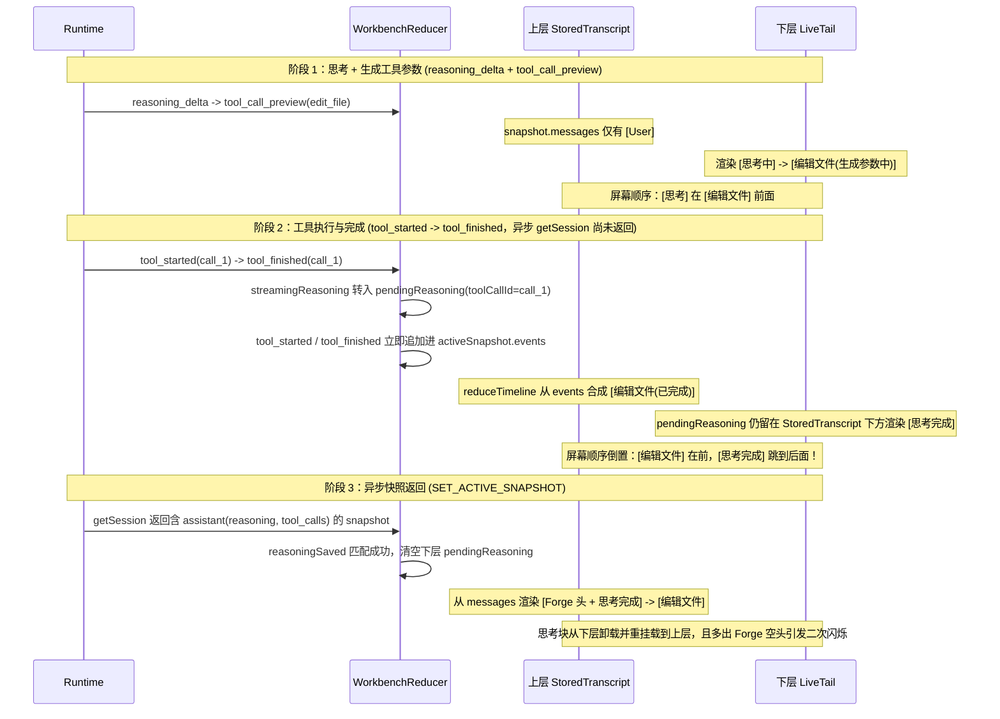

# 对话流思考自动收起与工具调用时序归并修改计划

> 本文档记录针对 Forge 渲染端（`src/renderer/**`）与核心运行时（`src/core/runtime.ts`）在多步工具调用场景下出现的**「思考完成未自动收起」**及**「思考组件与工具调用卡片前后顺序跳变、闪烁」**问题的完整根因分析与分步修改计划。
>
> - 关联文件：
>   - `src/core/runtime.ts`
>   - `src/renderer/state/workbench-reducer.ts`
>   - `src/renderer/state/transcript-sync.ts`
>   - `src/renderer/components/workbench/Transcript.tsx`
> - 设计契约：遵循 [DESIGN.md §9 思考内容显示契约](../DESIGN.md) 与 [DESIGN.md §11 对话流作者层级、去重与整段复制](../DESIGN.md)。

---

## 1. 现象描述

在实际使用包含思考（`reasoning_delta`）与工具调用（如 `edit_file`、`read_file`、`run_command`）的对话轮次时，出现以下两类核心问题：

1. **思考结束后没有自动收起**：
   模型思考已经完成，界面下方已经出现工具参数流式生成卡片（如「编辑文件 · 生成参数中」），但上方的思考组件仍然停留在展开的 5 行「思考中」状态，没有自动收起为单行「思考完成」摘要。
2. **思考与工具调用组件顺序反转并闪烁**：
   在「编辑文件」参数生成阶段，「思考中」组件位于「编辑文件」组件**上方**；但当「编辑文件」开始执行或执行结束的瞬间，画面闪烁一下，变成「思考完成」的组件跳到了「编辑文件」组件的**下方（后面）**；随后在异步会话快照（`getSession` / `SET_ACTIVE_SNAPSHOT`）返回时又发生二次跳动，导致多步工具调用的组件顺序错乱。

---

## 2. 完整时序与根因诊断

### 2.1 根因一：`Transcript.tsx` 仅将「回答正文开始」视为思考阶段结束，忽略了工具参数生成阶段

1. **渲染端判定缺陷**（`src/renderer/components/workbench/Transcript.tsx:621-624`、`732`）：
   ```tsx
   const answerStarted =
     Boolean(run?.streamingText) ||
     (snapshot?.messages.at(-1)?.role === "assistant" &&
       Boolean(snapshot?.messages.at(-1)?.content));
   // ...
   live={!run.streamingText && !answerStarted}
   ```
   - 当模型在当前步结束思考、开始流式生成工具调用参数（触发 `tool_call_preview`）时，由于模型本步是发起工具调用而非直接输出正文，`run.streamingText` 始终为空字符串 `""`，`answerStarted` 也为 `false`。
   - 对比 CLI 渲染器（`src/cli/render/events.ts:236-265`）：CLI 在收到 `text_delta`、`tool_call_preview`、`tool_started` 时均立即结束思考阶段。而共享 renderer 漏判了 `tool_call_preview` / `tool_preview_reset` / `context_usage`，导致在整个工具参数生成期间（对 `edit_file` 往往持续数秒），`<Reasoning>` 一直保持 `live={true}`（「思考中」）。

2. **运行时 22ms 思考缓冲定时器未在工具预览/正文前冲刷**（`src/core/runtime.ts:560-611`）：
   - `runtime.ts` 对未满 256 字符的 `reasoningPartial` 设置了 22ms 的 `reasoningTimer` 节流。
   - 当 provider 从思考切换到 `onText` 或 `onToolCall` 时，未先调用 `flushReasoning()`，且 `.finally()` 中 `flush()` 先于 `flushReasoning()` 执行。这会导致最后一段 `<256` 字符的 `reasoning_delta` 晚于第一帧 `tool_call_preview` 或 `text_delta` 发出。

---

### 2.2 根因二：`StoredTranscript` 与实时尾部（Live Tail）分层渲染导致工具执行期间顺序倒置

`src/renderer/components/workbench/Transcript.tsx:691-756` 将对话区拆分为**上下两个独立层级**：

- **上层（`<StoredTranscript snapshot={snapshot} />`）**：渲染 `reduceTimeline(snapshot)`（包含已持久化的 `snapshot.messages`，以及由 `snapshot.events` 中的 `tool_started` / `tool_finished` 实时合成的工具卡片）。
- **下层（`StoredTranscript` 下方的 Live Tail）**：依次渲染 `run.pendingOutputs` → `run.pendingReasoning` → `run.streamingReasoning` → `run.streamingText` → `<ToolPreviews />`。

这直接导致一次 `edit_file` 工具调用经历以下三阶段跳变：



---

### 2.3 根因三：中间纯工具步骤落盘后多渲染空 `Forge` 作者头，以及跨步前缀误匹配隐患

1. **空正文步骤的 `Forge` 作者头跳变**（`src/renderer/components/workbench/Transcript.tsx:308-329`）：
   - 当某一步 assistant 消息仅包含 `reasoning` 与 `tool_calls`、无回答正文（`content: null`）时，`timeline.ts` 会生成 `{ kind: "message", role: "assistant", content: "", reasoning: "..." }`。
   - 在流式阶段（`streamingReasoning` / `pendingReasoning`），界面只渲染裸 `<Reasoning />`；但当 `SET_ACTIVE_SNAPSHOT` 到达后，`renderTimelineEntry` 会外包一层 `<article className="message message-assistant">` 并渲染 22px 高的 `<div className="message-header"><span>Forge</span></div>`，导致落盘瞬间插入 28px 高的空作者行。
2. **多步工具调用的跨步同步游标与前缀匹配**（`src/renderer/state/transcript-sync.ts:11-46`）：
   - `outputSaved` 与 `reasoningSaved` 在 `!output.toolCallId`（如实时流 `live-reasoning` / `live-streaming`）时未限制 `!message.tool_calls?.length`。若第 1 步（含工具调用）的异步快照在第 2 步刚流式输出前几个字符时才到达，且第 2 步思考/正文与第 1 步有相同前缀（如“我先…”），第 1 步已落盘的 assistant 消息会误将第 2 步正在流式的 `streamingReasoning` / `streamingText` 清空。

---

## 3. 分步修改方案

### 步骤 1：`src/core/runtime.ts` — 在进入正文或工具预览前冲刷思考缓冲

- **修改位置**：`src/core/runtime.ts:586-622`
- **实现要点**：
  1. 在 `onText` 与 `onToolCall` 回调入口处先调用 `flushReasoning()`，确保任何缓存在 `reasoningPartial` 中的尾部思考字符先于 `text_delta` 或 `tool_call_preview` 发出。
  2. 在 `.finally()` 中先执行 `flushReasoning()` 再执行 `flush()`。
- **代码片段**：
  ```ts
  onText: (text) => {
    if (!streaming || typeof text !== "string") return;
    flushReasoning();
    const accepted = text.slice(
      0,
      Math.max(0, 131072 - emittedChars - partial.length),
    );
    partial += accepted;
    incompleteText += accepted;
    if (partial.length >= 8192) flush();
    else if (partial && flushTimer === undefined)
      flushTimer = setTimeout(flush, 80);
  },
  onToolCall: (preview) => {
    if (!streaming) return;
    flushReasoning();
    previews.push(preview);
  },
  ```
  ```ts
  .finally(() => {
    streaming = false;
    flushReasoning();
    flush();
    previews.close();
  });
  ```

---

### 步骤 2：`src/renderer/state/workbench-reducer.ts` & `src/renderer/state/transcript-sync.ts` — 显式标记思考完成并加固跨步去重

#### 2.1 在 `ActiveRunState` 中维护 `reasoningDone`
- **修改位置**：`src/renderer/state/workbench-reducer.ts:33-62`、`328-338`、`452-575`
- **实现要点**：
  - 在 `ActiveRunState` 中新增 `readonly reasoningDone?: boolean`。
  - `reasoning_delta` 到达时设 `reasoningDone: false`。
  - `tool_call_preview`、`tool_preview_reset`、`context_usage`、`text_delta` 到达时设 `reasoningDone: true`（使思考块在工具参数开始生成或正文开始生成的那一刻立即收起为「思考完成」）。
  - `tool_started`、`retry_reset`、`run_started` 清空 `streamingReasoning` 时重置 `reasoningDone: false`。
  - 在 `SET_ACTIVE_SNAPSHOT` 中，当 `streamingText` 或 `streamingReasoning` 为空（或被 `liveSaved` / `reasoningSavedLive` 清空）时，将 `streamStartMessage` / `reasoningStartMessage` 推进至 `selectedSnapshot.messages.length`。

#### 2.2 加固 `outputSaved` 与 `reasoningSaved`
- **修改位置**：`src/renderer/state/transcript-sync.ts:11-46`
- **代码片段**：
  ```ts
  export function outputSaved(
    output: PendingOutput,
    snapshot: SessionSnapshot | null,
  ): boolean {
    if (!snapshot) return false;
    const start =
      output.afterMessage <= snapshot.messages.length ? output.afterMessage : 0;
    return snapshot.messages.slice(start).some(
      (message) =>
        message.role === "assistant" &&
        (output.toolCallId
          ? message.tool_calls?.some((call) => call.id === output.toolCallId) &&
            Boolean(message.content)
          : !message.tool_calls?.length &&
            Boolean(message.content?.startsWith(output.text))),
    );
  }

  export function reasoningSaved(
    output: PendingOutput,
    snapshot: SessionSnapshot | null,
  ): boolean {
    if (!snapshot) return false;
    const start =
      output.afterMessage <= snapshot.messages.length ? output.afterMessage : 0;
    return snapshot.messages.slice(start).some(
      (message) =>
        message.role === "assistant" &&
        Boolean(message.reasoning?.startsWith(output.text)) &&
        (output.toolCallId
          ? Boolean(
              message.tool_calls?.some((call) => call.id === output.toolCallId),
            )
          : !message.tool_calls?.length),
    );
  }
  ```

---

### 步骤 3：`src/renderer/components/workbench/Transcript.tsx` — 按 `toolCallId` 将待同步思考/输出原位归并到对应工具之前

- **修改位置**：`src/renderer/components/workbench/Transcript.tsx`
- **实现要点**：
  1. 新增 `mergePendingTimeline(timeline, pendingOutputs, pendingReasoning)`：
     - 遍历 `reduceTimeline(snapshot)` 生成的 `timeline`。
     - 遇到 `item.kind === "tool"` 时，查找 `pendingReasoning` 和 `pendingOutputs` 中 `toolCallId === item.call.id` 的待同步项，在当前 `tool` 项**正前方**插入合成的 `assistant` 消息项。
     - 返回归并后的 `timeline` 以及未绑定到具体工具项的剩余 `unanchoredOutputs` / `unanchoredReasoning`。
  2. 将 `run?.pendingOutputs` 与 `run?.pendingReasoning` 传入 `StoredTranscript` 进行原位归并渲染；`Transcript` 底部仅渲染 `unanchoredOutputs` 与 `unanchoredReasoning`。
  3. 更新实时思考块的 `live` 判定：
     ```tsx
     const reasoningLive =
       !run.reasoningDone &&
       !run.streamingText &&
       !(run.toolPreviews && run.toolPreviews.length > 0) &&
       !answerStarted;
     ```
- **代码片段**：
  ```tsx
  function mergePendingTimeline(
    timeline: readonly TimelineItem[],
    pendingOutputs: readonly PendingOutput[] = [],
    pendingReasoning: readonly PendingOutput[] = [],
  ): {
    readonly timeline: readonly TimelineItem[];
    readonly unanchoredOutputs: readonly PendingOutput[];
    readonly unanchoredReasoning: readonly PendingOutput[];
  } {
    if (pendingOutputs.length === 0 && pendingReasoning.length === 0) {
      return {
        timeline,
        unanchoredOutputs: pendingOutputs,
        unanchoredReasoning: pendingReasoning,
      };
    }
    const consumedOutputs = new Set<string>();
    const consumedReasoning = new Set<string>();
    const merged: TimelineItem[] = [];

    for (const item of timeline) {
      if (item.kind === "tool") {
        const callId = item.call.id;
        const matchedReasoning = pendingReasoning.filter(
          (r) => r.toolCallId === callId && !consumedReasoning.has(r.id),
        );
        const matchedOutputs = pendingOutputs.filter(
          (o) => o.toolCallId === callId && !consumedOutputs.has(o.id),
        );
        for (const r of matchedReasoning) consumedReasoning.add(r.id);
        for (const o of matchedOutputs) consumedOutputs.add(o.id);

        if (matchedReasoning.length > 0 || matchedOutputs.length > 0) {
          const reasoningText = matchedReasoning.map((r) => r.text).join("");
          const contentText = matchedOutputs.map((o) => o.text).join("");
          const reasoningTruncated = matchedReasoning.some((r) => r.truncated);
          merged.push({
            kind: "message",
            id: `pending:${callId}`,
            role: "assistant",
            content: contentText,
            ...(reasoningText
              ? { reasoning: reasoningText, reasoningTruncated }
              : {}),
          });
        }
      }
      merged.push(item);
    }

    return {
      timeline: merged,
      unanchoredOutputs: pendingOutputs.filter((o) => !consumedOutputs.has(o.id)),
      unanchoredReasoning: pendingReasoning.filter(
        (r) => !consumedReasoning.has(r.id),
      ),
    };
  }
  ```

---

### 步骤 4：`src/renderer/components/workbench/Transcript.tsx` — 纯思考+工具步骤不渲染空 `Forge` 作者头

- **修改位置**：`src/renderer/components/workbench/Transcript.tsx:308-329`（`renderTimelineEntry`）
- **实现要点**：
  当 `item.kind === "message"` 且 `item.role === "assistant" && !item.content && item.reasoning` 时，直接渲染 `<StageHeader />`（若有）与 `<Reasoning />`，不包裹空正文的 `<article className="message message-assistant">` 与 `Forge` 作者栏，保证流式阶段、待同步阶段与快照落盘阶段 DOM 结构及高度完全一致。
- **代码片段**：
  ```tsx
  if (item.kind === "message") {
    if (item.role === "assistant" && !item.content && item.reasoning) {
      return (
        <Fragment key={item.id}>
          {headers[index] && <StageHeader stage={headers[index]} />}
          <Reasoning
            text={item.reasoning}
            truncated={Boolean(item.reasoningTruncated)}
          />
        </Fragment>
      );
    }
    // 其余含 item.content 的消息保持原有 <article className="message message-assistant"> 渲染
  }
  ```

---

## 4. 修改前后全阶段状态对比

| 阶段 | 触发事件 | 修改前表现 | 修改后表现 |
| --- | --- | --- | --- |
| 1. 思考流式 | `reasoning_delta` | `[思考中(展开)]` | `[思考中(展开)]` |
| 2. 工具参数生成 | `tool_call_preview` | `[思考中(未收起!)] → [编辑文件(生成参数中)]` | `[思考完成(自动收起)] → [编辑文件(生成参数中)]` |
| 3. 工具开始执行 | `tool_started`（快照未回） | `[编辑文件(执行中)] → [思考完成]`（顺序倒置） | `[思考完成] → [编辑文件(执行中)]`（顺序恒定） |
| 4. 工具执行完成 | `tool_finished`（快照未回） | `[编辑文件(已完成)] → [思考完成]`（顺序倒置） | `[思考完成] → [编辑文件(已完成)]`（顺序恒定） |
| 5. 快照落盘同步 | `SET_ACTIVE_SNAPSHOT` | 思考块从底部卸载跳回顶部，并多插入 `Forge` 空头 | `[思考完成] → [编辑文件(已完成)]`（原位平滑交接） |

---

## 5. 验收与测试标准

1. **思考完成自动收起测试**（`tests/renderer/reasoning-mounted.test.ts`）：
   - 派发 `reasoning_delta` 时 `.reasoning-live` 存在；
   - 派发 `tool_call_preview`（无 `text_delta`）时，`.reasoning-live` 立即消失，`.reasoning-done` 立即出现并显示最后一行摘要。
2. **思考与工具卡片顺序不变量测试**（`tests/renderer/tool-live-mounted.test.ts`）：
   - 按真实时序推进 `reasoning_delta` → `tool_call_preview(edit_file)` → `tool_started(edit_file)` → `tool_finished(edit_file)` → `SET_ACTIVE_SNAPSHOT`；
   - 每个阶段测量 DOM 几何位置，断言 `.reasoning-done` 的 `top` 始终严格小于 `.tool-disclosure` 的 `top`，全程无前后翻转、无额外 `.message-assistant` 空头插入。
3. **全量渲染端回归**：
   - 运行 `npx vitest run tests/renderer/`，确保全部渲染端测试通过。
